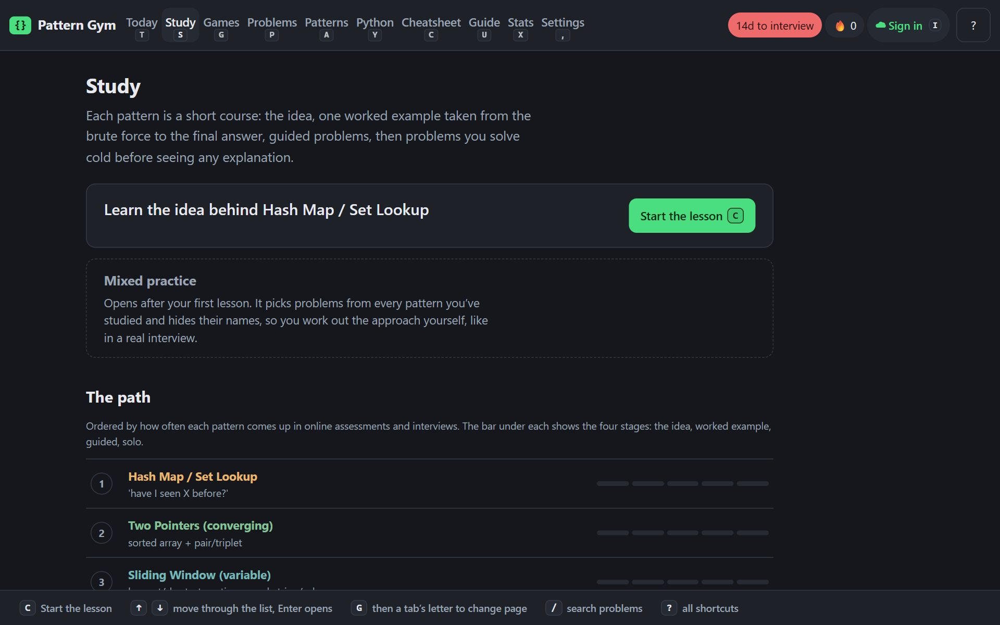

<div align="center">

# `{}` Pattern Gym

**Daily drills for coding interviews in Python: learn the approach, not 150 memorised answers.**

[](https://github.com/NAIRBS/pattern-gym/actions/workflows/pages.yml)


### [**Open the app →**](https://nairbs.github.io/pattern-gym/)

Runs in your browser (your code runs there too) · or locally with `python server.py`



</div>

---

## Contents

- [What's inside](#whats-inside)
- [The grind guide](#the-grind-guide)
- [The Study tab](#the-study-tab)
- [The games](#the-games)
- [Keyboard](#keyboard)
- [Online or local](#online-or-local)
- [Accounts and sync](#accounts-and-sync)
- [Project layout](#project-layout)
- [Adding a problem](#adding-a-problem)
- [Deploying](#deploying)

---

## What's inside

|  |  |
|---|---|
| 📚 **173 problems** | The NeetCode 150 plus 23 twists, each with a reference solution, real tests, a walkthrough and edge cases |
| 🐢 **Hidden large tests** | 75 problems also run a large hidden input, so correct but slow code fails, like on LeetCode |
| 🧭 **23 patterns** | A short course for each, from the idea to problems you solve cold |
| 🎮 **9 games** | From spotting a pattern in seconds to a full mock interview |
| 🔁 **Spaced repetition** | Nailed items come back after 1, 3, 7, 14, 30… days; blanked ones tomorrow. A full solve you passed comes back as a *different* problem of the same pattern |
| 🔗 **Out-links** | Every problem links to LeetCode (slugs checked against LeetCode's API) and to NeetCode's video |
| 🗺️ **The grind guide** | One page: the 8-week plan, a daily routine, and which outside resource is best for what |
| ⏰ **Interview date** | Within 14 days, urgent mode packs reviews closer so everything gets reps |
| ⌨️ **Keyboard-first** | The bar at the bottom always shows the keys for the screen you're on |
| ☁️ **Optional sync** | Sign in with an email link; progress from every device is combined, never overwritten |

## The grind guide

The app is one piece of getting good at coding interviews. The **Guide** tab (<kbd>G</kbd> <kbd>U</kbd>) is the rest of the map;
here is the short version.

**Five rules.** Learn patterns, not problems. Attempt before you read (25–40 minutes cold). Re-solve what you failed,
from a blank editor, a day later. Say the brute force and its cost before you code. Practise out loud, under a clock.

| When | Focus | Here | Elsewhere |
|---|---|---|---|
| Days 1–3 | Python fluency | Syntax Snap; set your interview date | LeetCode's editor and class-based signatures |
| Weeks 1–4 | Patterns | One Study course every day or two, ending in its transfer check | Submit each problem on LeetCode too; the NeetCode video only after a real attempt |
| Weeks 3–8 | Volume | The Today plan's reviews, every day | [Grind 75](https://www.techinterviewhandbook.org/grind75) or the [NeetCode 150](https://neetcode.io/practice) on LeetCode, timed |
| Weeks 6–8 | Speed and pressure | Mixed practice and OA Mode with the hidden tests | A [LeetCode contest](https://leetcode.com/contest/) a week; company-tagged lists if you have Premium |
| From week 4 | Talking | Mock Interview, weekly | [Pramp](https://www.pramp.com) peers, [interviewing.io](https://interviewing.io) mocks and recordings |

**A day (60–90 min):** reviews first (10–20 min) → one new problem cold with a timer (25–45 min) → if you missed it, read
the explanation, close it, and write it from blank (10–15 min) → one line on the signal you should have spotted.

<details>
<summary><b>Which resource is best for what</b></summary>

| Resource | Best at | Cost | Use it for |
|---|---|---|---|
| [LeetCode](https://leetcode.com) | The real judge, thousands of problems, Editorials, contests, company tags (Premium) | Free / Premium | Your main volume; submit everything you learn here there too |
| [NeetCode](https://neetcode.io) | The NeetCode 150 roadmap and a clear video for every problem | Free / Pro | Explanations, after you've tried |
| [Tech Interview Handbook](https://www.techinterviewhandbook.org) | Grind 75 schedules, topic cheatsheets, behavioural, resume and negotiation guides | Free | Your problem list and everything outside coding |
| [USACO Guide](https://usaco.guide) | A deep algorithms curriculum, Bronze to Platinum | Free | When a topic won't click: read its Silver or Gold module |
| [AlgoMonster](https://algo.monster) / Grokking | Pattern-first text courses | Paid | Optional second explanation of a pattern |
| [interviewing.io](https://interviewing.io) · [Pramp](https://www.pramp.com) | Practice with real people | Paid · Free | The last few weeks: nothing else trains the nerves |
| [AtCoder](https://atcoder.jp) · [Codeforces](https://codeforces.com) | Contest speed | Free | Optional, after the patterns |
| [System Design Primer](https://github.com/donnemartin/system-design-primer) | System design | Free | Not covered here |

</details>

## The Study tab

Memorising solutions doesn't carry over to problems you haven't seen. Recognising a pattern from the problem's *features*,
and having a method for when you don't recognise it, does. So each pattern is a short course:

| Stage | What you do |
|---|---|
| **1 · The idea** | Why the pattern exists, the cues that point to it, when it's a *different* pattern, and its skeleton with the job of each line (state, loop, decide, update, answer) |
| **2 · Worked example** | One problem taken from the **naive brute force** (real code that passes the tests) **to the final answer** |
| **3 · Guided** | Three decisions, each checked as you make it: which pattern, how fast it must be, then the key lines run against the tests |
| **4 · Solo, cold** | Solve from a blank editor first; the walkthrough unlocks only after a real attempt |
| **5 · Transfer check** | A twist on one of the course's problems that appears nowhere else in the app. Solving it cold is the sign you learned the pattern, not the problems |

Then **mixed practice** picks a problem from the patterns you've studied and **hides its name and pattern**: the closest
thing to a question you've never seen. Unseen twists come first.

<details>
<summary><b>The approach every walkthrough follows</b></summary>

1. **Understand it:** what goes in, what comes out, what to ask
2. **Solve a tiny example by hand:** your hands' steps are your first algorithm
3. **Brute force:** the obvious correct way, and its cost
4. **Find the repeated work:** what does the brute force redo?
5. **Pick the tool that removes it:** the pattern, and the cue words that pointed to it
6. **Plan in plain words**
7. **Code it**
8. **Test it:** the edge cases, then time and space

You type a guess before each step is revealed. A meter shrinks from the brute-force cost to the final one as you go.

</details>

<p align="center"></p>

The cold-solve page has an **approach coach** (open for your first few attempts, then it steps back) and a
**3-step hint ladder**: the brute force → the tool → the plan. Each hint lowers the best grade you can get.

## The games

| Layer | Game | What it trains |
|---|---|---|
| Idea | ⚡ **Pattern Sprint** | Problem statement → pattern, under a timer |
| Structure | 🧩 **Line Up** | Put a shuffled real solution back in order: drag, click or keyboard |
| Structure | 🦴 **Skeleton Recall** | Write a pattern's template from memory; hints step up, feedback lists what's missing |
| Structure → code | ✍️ **Fill the Gap** | Write the 2–4 key lines that make the skeleton solve *this* problem |
| Syntax | 🐍 **Syntax Snap** | One-line Python idioms, executed and checked |
| Full solve | 💻 **OA Mode** | Blank editor, timer, run button: online-assessment conditions |
| In person | ⏱️ **Big-O Call** | Call the time and space complexity of a solution |
| In person | 🔍 **Edge Hunter** | 60 s to list questions and edge cases, scored against the expected list |
| In person | 🎤 **Mock Interview** | Clarify → plan aloud → code with no run button → dry-run → score yourself |

- **Problems page:** search all 173 (twists are tagged) and solve any of them against the real tests.
- **Hidden large tests:** after the examples pass, OA Mode, cold solves and mocks run one or two large hidden inputs. Code that is right but too slow gets *"Correct on every example, but too slow on large hidden test 1 of 1 (n = 40,000)"*. Line Up and Fill the Gap skip them.
- **Answers:** "Show answer" toggles, so you can hide it and keep working, but seeing it once records the round as missed.
- **← Previous** reopens the last question and undoes the grade you gave it.
- **Code editors** have optional syntax colours (toggle on the editor itself, no autocomplete) and Python-friendly indentation: Tab / Shift+Tab indent or dedent the selection, Backspace removes 4 leading spaces, Enter keeps the indent.

<p align="center"></p>

## Keyboard

The bar at the bottom of every screen lists the keys that work right there, and every chip is clickable. Press <kbd>?</kbd> for the full list.

| Anywhere | | In a game | |
|---|---|---|---|
| <kbd>?</kbd> | all shortcuts | <kbd>E</kbd> / <kbd>Esc</kbd> | into / out of the editor |
| <kbd>/</kbd> | search problems | <kbd>Ctrl</kbd>+<kbd>Enter</kbd> | run / check |
| <kbd>G</kbd> then <kbd>T</kbd> <kbd>S</kbd> <kbd>G</kbd> <kbd>P</kbd> <kbd>A</kbd> <kbd>U</kbd> <kbd>X</kbd> <kbd>,</kbd> | go to a page | <kbd>H</kbd> · <kbd>A</kbd> | hint · show / hide answer |
| <kbd>C</kbd> | continue studying | <kbd>N</kbd> · <kbd>[</kbd> | next · previous question |
| <kbd>M</kbd> | mystery problem | <kbd>1</kbd> <kbd>2</kbd> <kbd>3</kbd> | grade: blanked / shaky / nailed |
| <kbd>Space</kbd> | reveal the next step | <kbd>Q</kbd> | exit the game |

## Online or local

|  | 🌐 Online | 💻 Local |
|---|---|---|
| **Open** | [nairbs.github.io/pattern-gym](https://nairbs.github.io/pattern-gym/) | http://localhost:8787 |
| **Needs** | A browser | Python 3.10+ (standard library only) |
| **Your code runs** | In your browser ([Pyodide](https://pyodide.org)) | On your machine (`runner.py`) |
| **Progress is saved in** | That browser | `progress.json` next to `server.py` |

<details>
<summary><b>Run it locally</b></summary>

```bash
git clone https://github.com/NAIRBS/pattern-gym.git
cd pattern-gym
python server.py          # Mac/Linux: python3 server.py
```

Then open http://localhost:8787. On Windows you can double-click `start.bat`. Update with `git pull`.
Use another port with `PORT=9000 python3 server.py` (Windows: `set PORT=9000` first).

</details>

> [!TIP]
> Online, the first **Run** downloads Python (about 10 MB, a few seconds); after that it's cached.
> Clearing the site's data erases progress you haven't synced, so sign in or use **Settings → Download backup**.

## Accounts and sync

Optional. Sign in under **Settings → Account & sync**: enter your email, then open the link it sends **in the same browser**.

- Progress is always saved on the device first, then synced: on load, a few seconds after each change, and when you're back online.
- Devices are **combined, never overwritten**: each drill keeps its latest review, XP and daily totals take the higher value,
  lessons, attempts and mock interviews are merged, and the most recently changed settings win.
- Only **Restore from backup** and **Reset** replace the cloud copy, and both ask first.
- The ☁ pill in the header shows the sync status.

The Supabase URL and publishable key live in `static/config.js`. They're public by design, because row-level security limits
each user to their own row. Empty them to turn sync off.

## Project layout

```text
pattern-gym/
├── server.py              local server: content, code runner, progress.json
├── runner.py              runs code against tests (subprocess locally, Pyodide online)
├── build_static.py        builds static/content.json for hosting
├── validate.py            every solution and brute-force version must pass its tests
├── content/               problems, twists, hidden-test generators (perf.py), LeetCode links, lessons, walkthroughs
├── static/                the whole app, which is what gets published
│   ├── app.js             pages, games, Study, keyboard
│   ├── guide.js           the grind guide page
│   ├── py-worker.js       Python in the browser
│   ├── sync.js · merge.js · config.js     sign-in and sync
│   └── edge-match.js      Edge Hunter scoring
├── tests/                 node tests for merge and edge matching
└── docs/NEXT_STEPS.md     project context: architecture, conventions, what's verified, to-dos
```

## Adding a problem

1. Append a `P(...)` entry to any `content/problems*.py` file.
2. Mark the key lines with `  # <<` (they become Fill the Gap blanks).
3. Optionally add a hidden large test in `content/perf.py`: a `make(rng)` that returns big inputs. Expected answers come from your reference solution, and validate checks that the brute force fails it.
4. Run `python validate.py` and check that it prints `ALL OK`.

Tests support plain functions, design classes (`D(...)`), linked lists and trees (`arg_types`), in-place mutation (`inplace=`),
custom node classes (`prelude=`), and a `harness=` for round-trips or problems with several valid answers.

## Deploying

Every push to `main` runs [`.github/workflows/pages.yml`](.github/workflows/pages.yml):

```text
validate.py  →  node tests  →  build_static.py  →  publish static/ to GitHub Pages
```

If any check fails, nothing is published. One-time setup: the repo must be public (or on GitHub Pro), with
**Settings → Pages → Source: GitHub Actions**. To try the static build locally:

```bash
python build_static.py && python -m http.server -d static 8000
```
