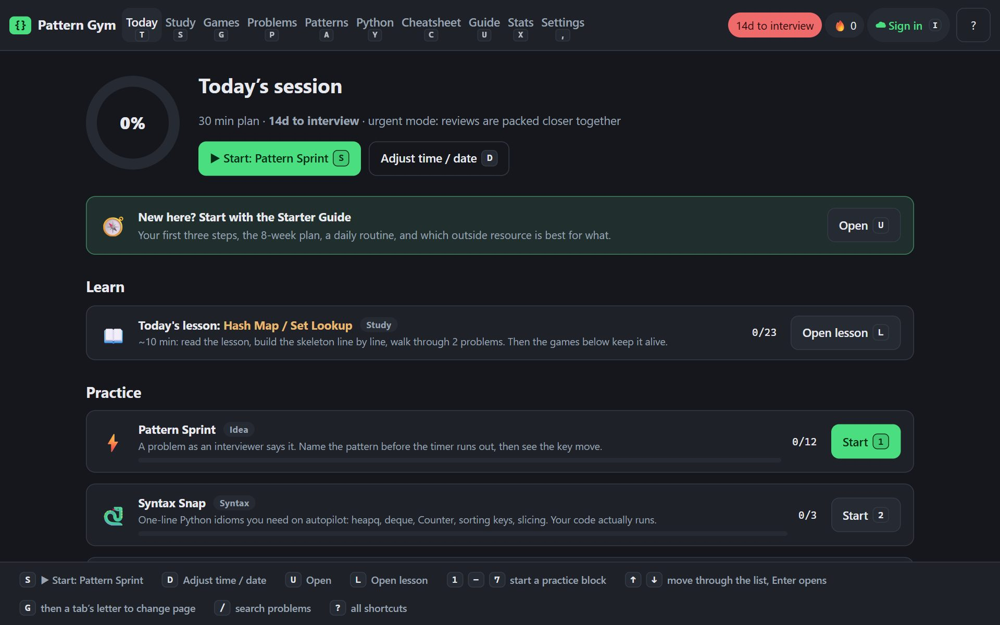
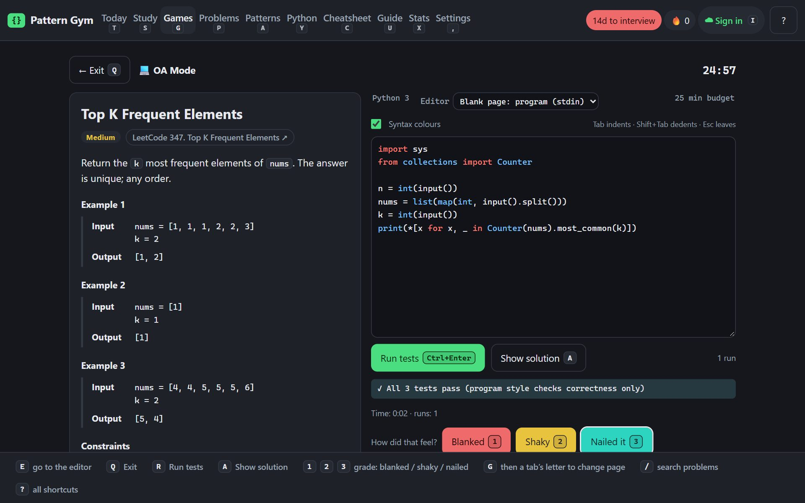
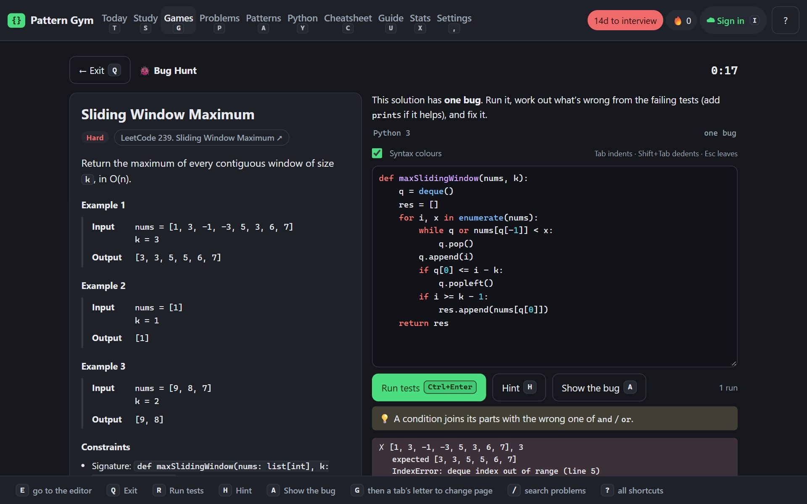
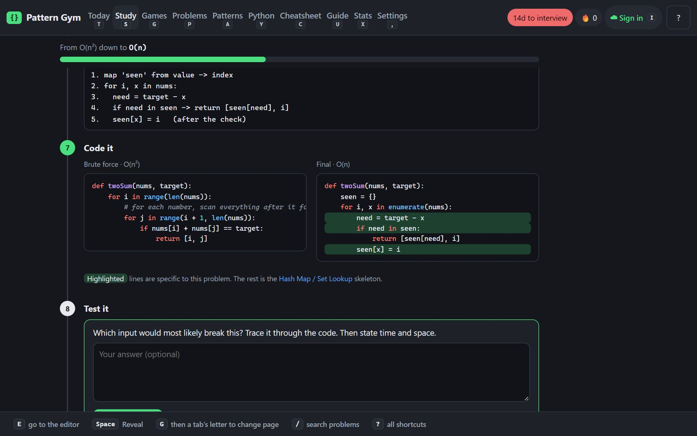
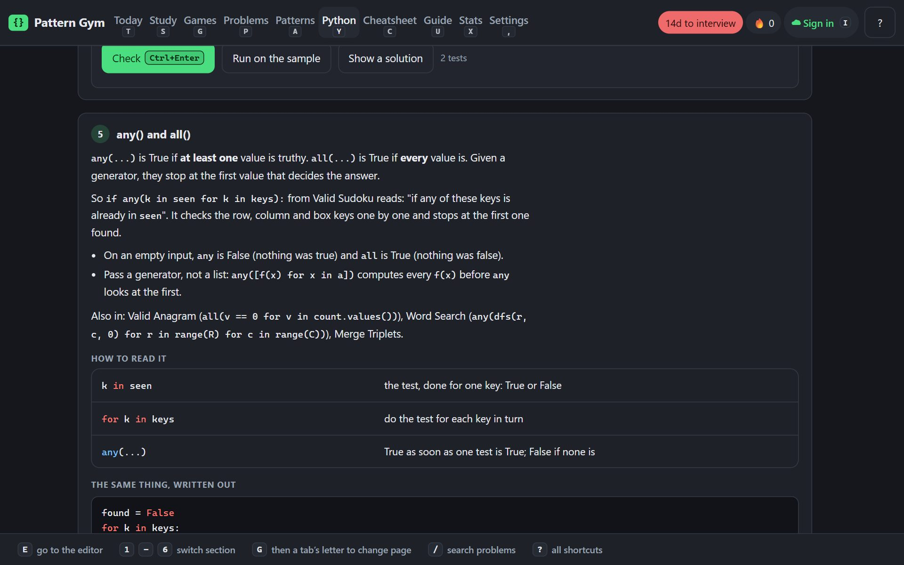
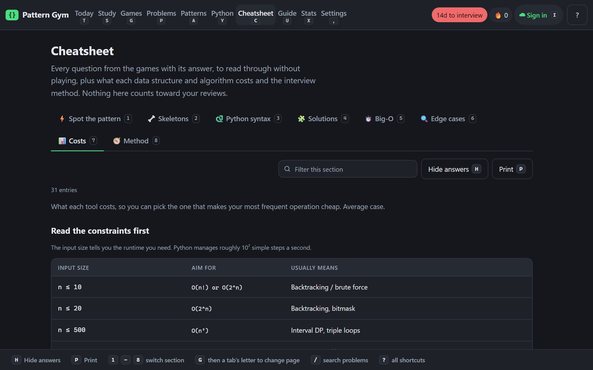
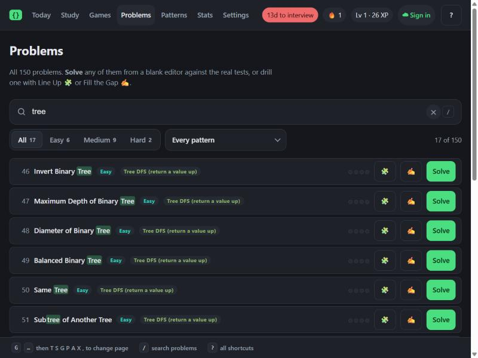

<div align="center">

# `{}` Pattern Gym

**Daily, spaced practice for Python coding interviews: online assessments and live blank-page (CoderPad) rounds.**

[](https://github.com/NAIRBS/pattern-gym/actions/workflows/pages.yml)


[**Open the app**](https://nairbs.github.io/pattern-gym/) · [Run it locally](#quick-start) · [How it works](docs/ARCHITECTURE.md)



</div>

You've done some LeetCode, but under pressure you can't recall which pattern fits, or you blank on the code once the
editor is empty. Pattern Gym drills exactly those parts (spotting the pattern, the code skeleton, the edge cases, the
complexity, writing a whole program from nothing) and brings each one back just before you'd forget it. It sits next to
LeetCode and NeetCode: use them for volume and explanations, and this for daily recall. Free, no sign-up, and your code
runs in your browser.

## Contents

- [Quick start](#quick-start)
- [Tour](#tour)
- [What's inside](#whats-inside)
- [Using it](#using-it): [Study](#study) · [Games](#games) · [CoderPad mode](#coderpad-mode) · [Python tab](#python-tab) · [Cheatsheet](#cheatsheet) · [Starter Guide](#starter-guide) · [Keyboard](#keyboard) · [Sync](#accounts-and-sync)
- [Developing](#developing): [Layout](#project-layout) · [Adding a problem](#adding-a-problem) · [Deploying](#deploying)

## Quick start

**Online:** open **[nairbs.github.io/pattern-gym](https://nairbs.github.io/pattern-gym/)**. Nothing to install.

**Locally** (Python 3.10+, standard library only):

```bash
git clone https://github.com/NAIRBS/pattern-gym.git
cd pattern-gym
python server.py          # then open http://localhost:8787
```

On Windows you can double-click `start.bat`. Another port: `PORT=9000 python server.py` (Windows: `set PORT=9000` first).

|  | 🌐 Online | 💻 Local |
|---|---|---|
| **Your code runs** | In your browser ([Pyodide](https://pyodide.org)) | On your machine (`runner.py`) |
| **Progress is saved in** | That browser (sync optional) | `progress.json` next to `server.py` |

> [!TIP]
> Online, the first **Run** downloads Python (about 10 MB, a few seconds); after that it's cached.
> Clearing the site's data erases progress you haven't synced, so sign in or use **Settings → Download backup**.

## Tour

<table>
<tr>
<td width="50%"><br><b>CoderPad mode.</b> Solve on a blank page, as a function with your own imports and helpers, or as a stdin/stdout program like a HackerRank OA.</td>
<td width="50%"><br><b>Bug Hunt.</b> A working solution with one realistic bug planted in it. Run it, read the failure, fix it.</td>
</tr>
<tr>
<td><br><b>Walkthroughs.</b> Every problem from the brute force to the final answer, revealed one step at a time after your own guess.</td>
<td><br><b>The Python tab.</b> The language for interviews, including how to read the dense one-liners, with code that runs.</td>
</tr>
<tr>
<td><br><b>Study.</b> 24 patterns in the order you should learn them, each a short course ending in a problem you've never seen.</td>
<td><br><b>Cheatsheet.</b> Every game question with its answer, plus what each data structure and algorithm costs.</td>
</tr>
</table>

## What's inside

|  |  |
|---|---|
| 📚 **180 problems** | The NeetCode 150, 7 starter problems that open courses gently, and 23 twists, each with a reference solution, real tests, a walkthrough and edge cases |
| 🐢 **Hidden large tests** | 75 problems also run a large hidden input, so correct but slow code fails, like on LeetCode |
| 🧭 **24 patterns** | A short course for each, in prerequisite order, from the idea to problems you solve cold |
| 🎮 **10 games** | From spotting a pattern in seconds to a full mock interview, including Bug Hunt: 260 realistic bugs to find and fix |
| 📝 **CoderPad mode** | Blank-page practice: your own imports, `ListNode`/`TreeNode` and tests, or stdin/stdout like a HackerRank OA (154 problems) |
| 🐍 **Python tab** | 45 lessons and 80 runnable quizzes: whole programs, input and output, the core language, reading one-liners |
| 📋 **Cheatsheet** | Every game question with its answer, data-structure and algorithm costs, and the interview method |
| 🔁 **Spaced repetition** | Nailed items come back after 1, 3, 7, 14, 30… days; blanked ones tomorrow. A passed full solve comes back as a *different* problem of the same pattern |
| ⏰ **Interview date** | Within 14 days, urgent mode packs reviews closer so everything gets reps |
| ⌨️ **Keyboard-first** | The bar at the bottom always shows the keys for the screen you're on |
| 🔗 **Out-links** | Every problem links to LeetCode (slugs checked against its API) and to NeetCode's video |
| ☁️ **Optional sync** | Sign in with an email link; progress from every device is combined, never overwritten |

## Using it

### Study

Memorising solutions doesn't carry over to problems you haven't seen. Recognising a pattern from the problem's *features*,
and having a method for when you don't, does. So each pattern is a short course, and the courses come in the order they
build on each other: **Big-O basics** first, then Hash Map, Prefix Sum, Two Pointers and so on, with **Recursion** before
trees, backtracking and DP, and Heap before shortest paths. Each lesson opens with a **"New to this?"** note on what it
assumes, with a link to the matching USACO Guide module. After every 4 lessons, a **checkpoint** asks for one mystery
problem with its name and pattern hidden.

| Stage | What you do |
|---|---|
| **1 · The idea** | Why the pattern exists, the cues that point to it, when it's a *different* pattern, and its skeleton with the job of each line |
| **2 · Worked example** | One problem taken from the **naive brute force** (real code that passes the tests) **to the final answer** |
| **3 · Guided** | Three decisions, each checked as you make it: which pattern, how fast it must be, then the key lines run against the tests |
| **4 · Solo, cold** | Solve from a blank editor first; the walkthrough unlocks only after a real attempt |
| **5 · Transfer check** | A twist that appears nowhere else in the app. Solving it cold shows you learned the pattern, not the problems |

**Mixed practice** then picks a problem from the patterns you've studied and **hides its name and pattern**, the closest thing
to a question you've never seen. The cold-solve page has an **approach coach** and a **3-step hint ladder** (the brute force →
the tool → the plan); each hint lowers the best grade you can get.

<details>
<summary><b>The approach every walkthrough follows</b></summary>

1. **Understand it:** what goes in, what comes out, what to ask
2. **Solve a tiny example by hand:** your hands' steps are your first algorithm
3. **Brute force:** the obvious correct way, and its cost
4. **Find the repeated work:** what does the brute force redo?
5. **Pick the tool that removes it:** the pattern, and the cue words that pointed to it
6. **Plan in plain words**
7. **Code it**
8. **Test it:** the edge cases, then time and space
9. **Another way?** (about 70 problems): a second approach with its cost and when you'd pick it, with code that passes the same tests

You type a guess before each step is revealed. A meter shrinks from the brute-force cost to the final one as you go.

</details>

### Games

| Layer | Game | What it trains |
|---|---|---|
| Idea | ⚡ **Pattern Sprint** | Problem statement → pattern, under a timer. When a second pattern also solves it, that counts as right too |
| Structure | 🧩 **Line Up** | Put a shuffled real solution back in order: drag, click or keyboard |
| Structure | 🦴 **Skeleton Recall** | Write a pattern's template from memory; hints step up, feedback lists what's missing |
| Structure → code | ✍️ **Fill the Gap** | Write the 2–4 key lines that make the skeleton solve *this* problem. After you finish the course, the loop and return lines are blank too |
| Syntax | 🐍 **Syntax Snap** | One-line Python idioms, executed and checked |
| Full solve | 🐞 **Bug Hunt** | Find and fix one planted bug: off-by-one, shared list, missing update, broken guard, wrong heap sign… |
| Full solve | 💻 **OA Mode** | Blank editor, timer, run button: online-assessment conditions, with the CoderPad switch |
| In person | ⏱️ **Big-O Call** | Call the time and space complexity of a solution |
| In person | 🔍 **Edge Hunter** | 60 s to list questions and edge cases, scored against the expected list |
| In person | 🎤 **Mock Interview** | Clarify → plan aloud → code with no run button → dry-run → score yourself on a rubric |

- **Hidden large tests:** after the examples pass, OA Mode, cold solves and mocks run one or two large hidden inputs. Code that is right but too slow gets *"Correct on every example, but too slow on large hidden test 1 of 1 (n = 40,000)"*.
- **Your `print` output** is shown with the results on every run, so you can debug the way you would without a judge.
- **Answers:** "Show answer" toggles, but seeing it once records the round as missed. **← Previous** undoes the last grade.
- **Editors** have syntax colours everywhere code appears (including Fill the Gap's gaps) and Python-friendly indentation: Tab / Shift+Tab indent the selection, Backspace removes 4 leading spaces, Enter keeps the indent.
- **Problems page:** search all 180 (twists are tagged) and solve any of them against the real tests.

<p align="center"></p>

### CoderPad mode

OA Mode and Mock Interview have an editor switch, remembered between problems:

| Mode | You get | Like |
|---|---|---|
| **LeetCode** | The function signature; imports, `ListNode` and `TreeNode` are already there | LeetCode, most OA platforms |
| **Blank page: function** | Nothing. Write the imports, any `ListNode`/`TreeNode`, the function and your own tests; the hidden tests still call your function | CoderPad, a shared editor |
| **Blank page: program** | The input and output format with a sample. Read stdin, print the answer; checked line by line (160 of 180 problems) | HackerRank-style OAs |

### Python tab

The Python you need for both settings (<kbd>G</kbd> <kbd>Y</kbd>), in six sections: how a program runs and how to write the
whole thing yourself (imports, your own `ListNode` / `TreeNode` / adjacency list, `assert` tests); data types; input and
output (`input()`, `split`/`map`, `sys.stdin` for fast input, `print` options, f-strings, file I/O, following the
[USACO Guide](https://usaco.guide/general/input-output?lang=py)); loops and functions; the containers; and **reading
one-liners**: comprehensions, generator expressions, `any`/`all`, `''.join`, `max(..., default=)`, `zip`, short-circuit
guards, `setdefault`, `iter`/`next` and bit tricks, each taken apart piece by piece, written out as a plain loop, and linked to
the solution lines that use it. Every example runs in the browser with its own stdin, and each lesson ends in quizzes that run:
**Predict** (type what the code prints) and **Write** (a program checked against several inputs).

### Cheatsheet

Everything the games ask, with the answers, to read without playing (<kbd>G</kbd> <kbd>C</kbd>): the 150 Pattern Sprint
prompts, the 24 skeletons, the 34 Syntax Snap idioms, and for every problem the reference solution, its Big-O, and its
clarifying questions and edge cases. **Costs** gives input size → target runtime and what each data structure and algorithm
costs, with Python notes; **Method** gives seven steps from an unseen problem to a tested program, and what to try when the
brute force is too slow. Filter by text or pattern, press <kbd>H</kbd> to blur the answers and quiz yourself, <kbd>P</kbd> to print.

### Starter Guide

The app is one piece of getting good at coding interviews; the **Starter Guide** (<kbd>G</kbd> <kbd>U</kbd>) is the rest of the map.

**Five rules.** Learn patterns, not problems. Attempt before you read (25–40 minutes cold). Re-solve what you failed, from a
blank editor, a day later. Say the brute force and its cost before you code. Practise out loud, under a clock.

**A day (60–90 min):** reviews first (10–20 min) → one new problem cold with a timer (25–45 min) → if you missed it, read the
explanation, close it, and write it from blank (10–15 min) → one line on the signal you should have spotted.

<details>
<summary><b>The 8-week plan</b></summary>

| When | Focus | Here | Elsewhere |
|---|---|---|---|
| Days 1–3 | Python fluency | Big-O basics, the Python tab and Syntax Snap; set your interview date if you have one | LeetCode's editor and class-based signatures |
| Weeks 1–4 | Patterns | One Study course every day or two, ending in its transfer check | Submit each problem on LeetCode too; the NeetCode video only after a real attempt |
| Weeks 3–8 | Volume | The problems here are the main list: every course's solo problems and the daily reviews | Submit them on LeetCode too; once the courses are done, [Grind 75](https://www.techinterviewhandbook.org/grind75) problems you haven't seen, timed (15 / 25 / 40 min) |
| Weeks 6–8 | Speed and pressure | Mixed practice, OA Mode with hidden tests, blank-page mode | A [LeetCode contest](https://leetcode.com/contest/) a week; company-tagged lists if you have Premium |
| From week 4 | Talking | Mock Interview, weekly | [Pramp](https://www.pramp.com) peers, [interviewing.io](https://interviewing.io) mocks and recordings |

</details>

<details>
<summary><b>Which outside resource is best for what</b></summary>

| Resource | Best at | Cost | Use it for |
|---|---|---|---|
| [LeetCode](https://leetcode.com) | The real judge, thousands of problems, Editorials, contests, company tags (Premium) | Free / Premium | Your main volume; submit everything you learn here there too |
| [NeetCode](https://neetcode.io) | The NeetCode 150 roadmap and a clear video for every problem | Free / Pro | Explanations, after you've tried |
| [Tech Interview Handbook](https://www.techinterviewhandbook.org) | Grind 75 schedules, topic cheatsheets, behavioural, resume and negotiation guides | Free | Your problem list and everything outside coding |
| [USACO Guide](https://usaco.guide) | A deep algorithms curriculum, Bronze to Platinum | Free | When a topic won't click: read its Silver or Gold module |
| [AlgoMonster](https://algo.monster) / Grokking | Pattern-first text courses | Paid | Optional second explanation of a pattern |
| [interviewing.io](https://interviewing.io) · [Pramp](https://www.pramp.com) | Practice with real people | Paid · Free | The last few weeks: nothing else trains the nerves |
| [AtCoder](https://atcoder.jp) · [Codeforces](https://codeforces.com) | Contest speed | Free | Optional, after the patterns |
| [System Design Primer](https://github.com/donnemartin/system-design-primer) | System design | Free | Not covered here |

</details>

### Time estimates

Everything shows how long it takes, so you can fit it into the time you have:

- **Reading:** lessons, Cheatsheet sections, Guide tabs and every other page show their reading time
  (200 words a minute, 5 seconds a line of code).
- **Doing:** each game round, each block of today's plan, each walkthrough, guided problem and Python quiz.
  Full solves use the online-assessment budgets: 15 minutes Easy, 25 Medium, 40 Hard.
- **Totals:** what's left today, in each Study course, in the whole Study path and in the Python tab.
- **Your pace:** after three questions in a game, its estimates switch from the default to your own measured pace.
  Hover a time to see which one it is.

### Theme

Light, dark, or the same as your device: **Settings → Theme**. Other open tabs switch too.

### Keyboard

The bar at the bottom of every screen lists the keys that work right there, and every chip is clickable. <kbd>?</kbd> shows them all.

| Anywhere | | In a game | |
|---|---|---|---|
| <kbd>?</kbd> | all shortcuts | <kbd>E</kbd> / <kbd>Esc</kbd> | into / out of the editor |
| <kbd>/</kbd> | search problems | <kbd>Ctrl</kbd>+<kbd>Enter</kbd> · <kbd>R</kbd> | run / check |
| <kbd>G</kbd> then <kbd>T</kbd> <kbd>S</kbd> <kbd>G</kbd> <kbd>P</kbd> <kbd>A</kbd> <kbd>Y</kbd> <kbd>C</kbd> <kbd>U</kbd> <kbd>X</kbd> <kbd>,</kbd> | go to a page | <kbd>H</kbd> · <kbd>A</kbd> | hint · show the answer (or the bug) |
| <kbd>C</kbd> | continue studying | <kbd>N</kbd> · <kbd>[</kbd> | next · previous question |
| <kbd>M</kbd> | mystery problem | <kbd>1</kbd> <kbd>2</kbd> <kbd>3</kbd> | grade: blanked / shaky / nailed |
| <kbd>Space</kbd> | reveal the next step | <kbd>Q</kbd> | exit (asks first) |

### Accounts and sync

Optional. Sign in under **Settings → Account & sync**: enter your email, then open the link it sends **in the same browser**.

- Progress is always saved on the device first, then synced: on load, a few seconds after each change, and when you're back online.
- Devices are **combined, never overwritten**: each drill keeps its latest review, XP and daily totals take the higher value,
  lessons, attempts and mock interviews are merged, and the most recently changed settings win.
- Only **Restore from backup** and **Reset** replace the cloud copy, and both ask first. The ☁ pill in the header shows the status.

The Supabase URL and publishable key in `static/config.js` are public by design: row-level security limits each user to their
own row. Empty them to turn sync off.

## Developing

### Project layout

```text
pattern-gym/
├── server.py              local server: content, code runner, progress.json
├── runner.py              runs code against tests (subprocess locally, Pyodide online)
├── build_static.py        builds static/content.json for hosting
├── validate.py            runs every piece of content: solutions, brute forces, quizzes, stdin programs, bugs
├── make_bugs.py           regenerates the Bug Hunt bugs (content/bug_hunt_data.py)
├── content/               problems, twists, hidden-test generators (perf.py), LeetCode links, lessons, walkthroughs,
│                          the Python tab (python_course.py), Cheatsheet tables (references.py), CoderPad program
│                          style (stdio.py) and Bug Hunt (bug_hunt.py, bug_hunt_data.py)
├── static/                the whole app, which is what gets published
│   ├── app.js             pages, games, Study, keyboard
│   ├── guide.js           the Starter Guide page
│   ├── cheatsheet.js      the Cheatsheet page
│   ├── python.js          the Python tab
│   ├── theme.js           light / dark / system, applied before the first paint
│   ├── py-worker.js       Python in the browser
│   ├── sync.js · merge.js · config.js     sign-in and sync
│   └── edge-match.js      Edge Hunter scoring
├── tests/                 node tests for merge, edge matching and the highlighter
└── docs/
    ├── ARCHITECTURE.md    how it all fits together: content, judge, app, progress, sync, CI
    ├── NEXT_STEPS.md      project context: conventions, what's verified, to-dos
    └── screenshots/       the images in this README
```

For build time vs run time, the test-spec format, hidden tests, the merge rules and the trade-offs, see
**[docs/ARCHITECTURE.md](docs/ARCHITECTURE.md)**.

### Adding a problem

1. Append a `P(...)` entry to any `content/problems*.py` file.
2. Mark the key lines with `  # <<` (they become Fill the Gap blanks).
3. Optionally add a hidden large test in `content/perf.py`: a `make(rng)` that returns big inputs. Expected answers come from your reference solution, and validate checks that the brute force fails it.
4. Run `python make_bugs.py` to give it Bug Hunt bugs (rerun it whenever you change a solution). Its stdin version for CoderPad mode is made automatically when its inputs fit a text format.
5. Run `python validate.py` and check that it prints `ALL OK`.

Tests support plain functions, design classes (`D(...)`), linked lists and trees (`arg_types`), in-place mutation (`inplace=`),
custom node classes (`prelude=`), and a `harness=` for round-trips or problems with several valid answers.

### Deploying

Every push to `main` runs [`.github/workflows/pages.yml`](.github/workflows/pages.yml):

```text
validate.py  →  node tests  →  build_static.py  →  publish static/ to GitHub Pages
```

If any check fails, nothing is published. One-time setup: the repo must be public (or on GitHub Pro), with
**Settings → Pages → Source: GitHub Actions**. To try the static build locally:

```bash
python build_static.py && python -m http.server -d static 8000
```
