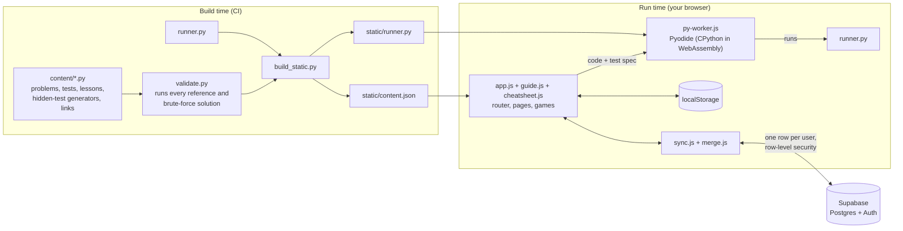

# Architecture

How Pattern Gym is put together: where the content lives, how your code gets run and judged, where progress
is stored, and how a change reaches the live site.

> **Keep this current.** Any change to the content model, the test-spec format, the state shape, the runtimes,
> sync or the deploy pipeline updates this file in the same commit. The [checklist](#keeping-this-document-current)
> at the end lists what to look at.

**Contents**
[At a glance](#at-a-glance) ·
[Two lifecycles](#two-lifecycles-build-time-and-run-time) ·
[Content](#content) ·
[Running code](#running-and-judging-code) ·
[The web app](#the-web-app) ·
[Progress and review](#progress-and-spaced-review) ·
[Accounts and sync](#accounts-and-sync) ·
[Quality gates](#quality-gates) ·
[Trade-offs](#design-decisions-and-trade-offs) ·
[Known limits](#known-limits) ·
[Where it would go next](#where-it-would-go-next)

---

## At a glance

Pattern Gym is a **static, offline-first web app**. There is no application server in production: the content is
compiled into one JSON file at build time, your Python runs inside your browser, and progress lives on your
device. An optional account syncs that progress through Supabase.



| Layer | Files | Job |
|---|---|---|
| Content | `content/*.py` | Every problem, test, walkthrough, lesson, drill card and hidden-test generator, as Python data |
| Build | `validate.py`, `build_static.py` | Check all content by running it, then compile it to `static/content.json` |
| Judge | `runner.py`, `static/py-worker.js` | Run untrusted code against a test spec, with a time limit |
| App | `static/app.js`, `static/guide.js`, `static/cheatsheet.js`, `static/index.html`, `static/style.css` | Hash router, pages, games, keyboard layer |
| Helpers | `static/highlight.js`, `static/edge-match.js` | Syntax colouring; matching typed edge cases to the expected ones |
| Progress | `static/merge.js`, `static/sync.js`, `static/config.js` | Local state, merging two copies, optional cloud sync |
| Local mode | `server.py`, `start.bat` | Same app served from your machine, code run in a subprocess, progress in `progress.json` |
| Delivery | `.github/workflows/pages.yml` | Validate → test → build → publish to GitHub Pages |

---

## Two lifecycles: build time and run time

**Build time** happens in CI on every push to `main` (and locally when you run the scripts):

1. `python validate.py` imports all content and *executes* it: every reference solution against its tests, every
   brute force against the hidden large tests (it must fail them), every drill answer against its check.
   Any failure stops the deploy.
2. `node tests/*.test.js` checks the pure JS modules (merge, edge matching).
3. `python build_static.py` calls `content.load_all()`, which joins the content modules into one object, and
   writes it to `static/content.json` (~420 KB). It also copies `runner.py` into `static/`.
4. `node tests/highlight.test.js` checks that colouring never changes code text.
5. `static/` is uploaded as the Pages site. The two generated files are gitignored.

**Run time** is entirely in the browser:

1. `index.html` loads `app.js`, then `guide.js` and `cheatsheet.js`. On boot, `loadContent()` tries `GET /api/content` (local
   mode); if that fails it fetches `content.json` (static mode) and sets `SERVER = false`.
2. Progress is read from `localStorage` (`pattern-gym-state`), normalised, and held in one object `S`.
3. The hash router renders the page for the current `#/route`.
4. When you run code, the page sends it to the Pyodide worker, which runs `runner.py` and reports results.

---

## Content

### Where it lives

| Module | Contents |
|---|---|
| `problems.py`, `problems_a.py`, `problems_b.py`, `problems_c.py` | The NeetCode 150: statement, insight, catch, complexity, clarifying questions, edge cases, reference solution, tests |
| `problems_twist.py` | 23 twist problems (`twist_of` points to the core problem they vary), with their own walkthrough and brute force |
| `perf.py` | Hidden large tests: a size label and a `make(rng)` generator per problem |
| `links.py` | LeetCode slug, number, title and Premium flag, checked against LeetCode's API |
| `patterns.py`, `study_patterns.py` | The patterns: skeleton, triggers, lesson content |
| `study_problems.py`, `study_brute.py` | Walkthrough plans and brute-force code |
| `sprint.py`, `syntax.py`, `interview.py` | Pattern Sprint cards, Syntax Snap drills, the interview rubric and method |
| `__init__.py` | `load_all()`: merges all of the above into the shape the app reads |

### The problem record

After `load_all()`, each problem in `content.json` looks like this (trimmed):

```jsonc
{
  "id": "two_sum", "num": 3, "title": "Two Sum", "pattern": "hashmap", "diff": "Easy",
  "statement": "Return indices of the two numbers in nums that add up to target. ...",
  "insight": "...", "catch": "...", "time": "O(n)", "space": "O(n)",
  "clarify": ["..."], "edges": ["..."],
  "solution": "def twoSum(nums, target): ...",   // reference; key lines marked in the source become key_lines
  "key_lines": [3, 5], "starter": "def twoSum(nums, target):\n    \n",
  "brute": "Check every pair: O(n²).", "brute_code": "...", "plan": ["..."],
  "lc": { "slug": "two-sum", "num": 1, "title": "Two Sum", "paid": false },
  "twist_of": null,                               // set on twist problems
  "tests": {
    "kind": "function", "fn": "twoSum",
    "cases": [{ "args": [[2, 7, 11, 15], 9], "expected": [0, 1] }],
    "compare": "...", "arg_types": null, "ret_type": null, "inplace": null, "harness": null,
    "perf": { "size": "n = 40,000", "gen": "def make(rng): ...", "ref": "<the reference solution>" }
  }
}
```

### Test specs

`runner.py` understands three kinds:

| Kind | Shape | Used for |
|---|---|---|
| `function` | `fn`, `cases[{args, expected}]` | Most problems |
| `design` | `cls`, `cases[{ops, args, expected}]` | Class problems (Min Stack, LRU Cache…), LeetCode's op-list format |
| `snippet` | `setup`, `check` | Syntax Snap: your line runs after `setup`; `check` must be true |

Options on `function` specs:

| Option | What it does |
|---|---|
| `arg_types` / `ret_type` | Convert between plain lists and `TreeNode` / `ListNode` (level order for trees) |
| `inplace` | Index of the argument the function modifies in place; that argument is compared, not the return value |
| `compare` | `unordered`, `unordered_nested` (order doesn't matter) or `float` (approximate) |
| `harness` | Custom checking code, for problems with more than one valid answer (topological orders, deep copies) |

The problem panel builds its LeetCode-style signature, examples and constraints from these same fields
(`problemPanel()` in `app.js`), so there is only one source of truth.

### Hidden large tests

A `perf.py` entry gives a size label and a seeded generator. `load_all()` attaches it to the test spec, together
with the reference solution. When OA Mode, a cold solve or a mock runs your code, `runner.py`:

1. runs the visible examples;
2. if they all pass, generates the large input and computes the expected answer **with the reference solution**,
   so large tests never need hand-written answers;
3. prints a `PROGRESS` note before each hidden test.

If the time limit hits after a `PROGRESS` note, the page knows every example passed and reports
*"correct, but too slow on large hidden test 1 of 1 (n = 40,000)"* instead of a bare timeout.

`validate.py` checks both directions: the reference must pass the large test well within the limit
(`PERF REF SLOW`), and the brute force must fail it (`PERF WEAK`). A hidden test that slow code can pass is
treated as a bug.

---

## Running and judging code

Both modes run the **same `runner.py`**, so a solution behaves the same locally and online.

| | Static (GitHub Pages) | Local (`python server.py`) |
|---|---|---|
| Where code runs | Web Worker running Pyodide (CPython compiled to WebAssembly), loaded from jsDelivr | A `python runner.py` subprocess |
| Time limit | 6 s per run (4 s for Syntax Snap) | 6 s (4 s for Syntax Snap) |
| Stopping an infinite loop | The page terminates the worker and starts a new one | `subprocess` timeout kills the process |
| Isolation | The browser sandbox; the code can only reach your own tab | Your own machine; it's your own code |

The worker loads Pyodide once and keeps it warm between runs. A crash that escapes Python (very deep recursion)
also triggers a fresh worker. `print()` output is discarded in both modes.

---

## The web app

**No framework, no bundler.** `app.js` is plain JavaScript in sections marked `// ───`. The main pieces:

| Piece | How it works |
|---|---|
| Router | `ROUTES[name] = (app, parts, params) => …`. `route()` runs on `hashchange`, calls the page's cleanup callbacks, renders, sets the title and moves focus to the `h1` |
| Pages | Each route writes HTML into `#app` with template strings. Every dynamic value goes through `esc()` |
| Games | A registry `GAMES[id] = { name, pool(), gate(), render(el, item, done, ctx) }`. Every game plugs into one session runner (`runSession`), which handles the queue, grading, Previous/undo, XP and the end screen. Each game only renders a question and calls `done(grade)` |
| Study | Courses per pattern: lesson → worked example → guided → solo cold → transfer check (a twist). `courseOf()` builds the stages; `nextStep()` picks what's next |
| Starter Guide | `guide.js` registers `ROUTES.guide`, a page with six sections addressed as `#/guide/<section>` |
| Cheatsheet | `cheatsheet.js` registers `ROUTES.cheatsheet`: every game question with its answer, read-only, in six sections (`#/cheatsheet/<section>`: sprint, skeletons, syntax, solutions, bigo, edges). It reads the same `C.sprint`, `C.patterns`, `C.syntax` and `C.problems` the games draw from, so it never goes stale. A filter, a pattern menu, a Hide answers mode (blurred until clicked) and print styles; nothing on it is graded or scheduled |
| Keyboard layer | Any button with `data-key="x"` gets that shortcut. One global `keydown` handler clicks the visible match. The key bar (`paintKeybar`) lists exactly the keys that work on the current screen |
| Problem panel | `problemPanel(p)` renders statement, examples, typed signature and constraints from the test spec |
| Editor | A `<textarea>` with a syntax-colour overlay (`highlight.js`), auto-indent and Tab handling (`enhanceEditor`) |

---

## Progress and spaced review

All progress is one JSON object, `S`:

```jsonc
{
  "items":  { "<game>:<id>": { "box": 3, "due": "2026-11-24", "last": "2026-11-17", "reps": 4 } },
  "xp": 120, "streak": { "count": 5, "last": "2026-11-20", "best": 9 },
  "days":   { "2026-11-20": { "xp": 30, "rounds": 4, "newBy": { "sprint": 2 } } },
  "mocks":  [ /* scored mock interviews */ ],
  "study":  { "lessons": {}, "walks": {}, "attempts": {} },
  "plan":   { /* today's blocks and how many are done */ },
  "settings": { "minutes": 30, "interviewDate": "...", "singleKeys": true, "...": "..." },
  "settingsAt": 1763600000000
}
```

- **Saving:** every change calls `save()`, which writes to `localStorage` in static mode or to
  `POST /api/state` (which writes `progress.json`) in local mode.
- **Spaced review (Leitner boxes):** each graded item sits in box 0–7. A pass moves it up a box and schedules
  it after 1, 3, 7, 14, 30, 60 or 120 days. The interval is capped when your interview date is near (urgent mode).
  "Shaky" brings it back in 1–2 days; a fail drops it to box 0 for tomorrow.
- **Review rotation:** when a full solve you passed comes due, `rotate()` swaps in the same-pattern sibling with
  the fewest reps, so you review the pattern, not one memorised answer. Grading credits both problems.
- **Today's plan:** blocks per game, sized to your daily minutes and how close your interview date is.

---

## Accounts and sync

Sync is optional. With no values in `config.js`, the app is fully local.

- **Sign-in:** Supabase Auth with an emailed link; no passwords.
- **Storage:** one row per user in a `progress` table holding the whole state as JSON. Row-level security lets
  each user read and write only their own row. The page only ever holds the *publishable* key.
- **Merging, not overwriting:** on sign-in and after changes, `sync.js` pulls the remote copy, combines it with the
  local one using `mergeState()` in `merge.js`, saves the result locally, and pushes it back.
- **Merge rules** are field by field, so two devices never lose each other's work:

| Field | Rule |
|---|---|
| `items` | The copy reviewed later wins; on a tie, more reps wins |
| `xp`, streak best | Maximum |
| `days` | Per day, maximum of each counter |
| `mocks` | Union by (date, problem) |
| `study` | Union, keeping the earliest date |
| `plan` | Later date wins; same day, per-game maximum |
| `settings` | The copy with the later `settingsAt` wins |

`merge.js` is a pure function with no DOM, which is why it can be tested in Node (`tests/merge.test.js`).

---

## Quality gates

`validate.py` runs every piece of content. Each failure has a code:

| Code | Means |
|---|---|
| `FAIL` | A reference solution fails its own tests |
| `STARTER` | The starter code generated from the solution doesn't compile |
| `NO KEY LINES` | A solution has no highlighted key lines |
| `UNKNOWN PATTERN` / `SPRINT PATTERN` | A problem or drill card points to a pattern that doesn't exist |
| `BRUTE FAIL` / `BRUTE COST` | A brute force gives wrong answers, or its description has no O(…) cost |
| `PERF REF FAIL` / `PERF REF SLOW` | The reference fails or is too slow on its own hidden test |
| `PERF WEAK` | The brute force passes the hidden test, so the test can't catch slow code |
| `NO WALKTHROUGH` / `INCOMPLETE LESSON` | Study content is missing |
| `SYNTAX FAIL` | A Syntax Snap answer fails its check |
| `DUPLICATE IDS` | Two records share an id |
| `BAD TWIST_OF` | A twist points to a missing problem, another pattern, or another twist |

The Node tests cover the pure modules: progress merging, edge-case matching and the highlighter.

---

## Design decisions and trade-offs

| Decision | Why | Cost |
|---|---|---|
| Static site, no backend | Free hosting, nothing to run or secure, works offline | No server-side secrets: hidden tests and solutions ship to the browser, so nothing stops a user from cheating themselves |
| Python in the browser (Pyodide) | Real CPython, no server bill, untrusted code stays in the user's own sandbox | ~10 MB first download; slower than native Python, so time limits are generous |
| One `runner.py` for both modes | A solution can't pass locally and fail online | The runner must stay standard-library only |
| Content as Python modules | Solutions are Python, and `validate.py` can import and run everything directly | Code lives inside strings, so editors and linters can't check it; content and code share one review process |
| Test answers from the reference | Large tests need no hand-written answers | The reference must be right; the regular tests are what check it |
| Progress as one JSON document | Simple to save, export, back up and merge | Every sync sends the whole document (fine at this size) |
| Field-by-field merge | No lost progress across devices, without a real-time protocol | Each new state field needs a merge rule |
| No framework | Zero dependencies, nothing to build, instant load | `app.js` is one large file with shared mutable state, and HTML built from strings relies on calling `esc()` everywhere |

---

## Known limits

- Python only. LeetCode stores a language-neutral signature and generates per-language stubs; this app doesn't.
- 173 problems with hand-written tests: far fewer cases per problem than a real judge.
- `app.js` (~2,000 lines) has no module boundaries or types, and its logic (scheduling, rotation, routing) has no
  unit tests yet.
- `server.py` and the static build are two code paths to keep in step.
- The first run of the day downloads Pyodide before code can run.

---

## Where it would go next

**Content as a package per problem.** Competitive-programming formats such as the
[ICPC / Kattis problem package format](https://icpc.io/problem-package-format/) and Codeforces Polygon already
match what this app does; they just keep it in separate files:

```
problems/two-sum/
  problem.yaml          id, title, difficulty, pattern, LeetCode link,
                        language-neutral signature: name, params with types, return type
  statement.md          the statement
  tests/sample.json     visible examples
  tests/generator.py    the hidden large test
  solutions/
    accepted.py         the reference
    brute_tle.py        must time out on the hidden test (validate already checks this)
  walkthrough.md        insight, catch, plan, edge cases
```

Real `.py` files get linting and syntax checking; Markdown and YAML are easy for contributors to edit; a JSON
Schema checks every `problem.yaml`; `build_static.py` still compiles everything to `content.json`. The language-neutral
signature is what would let the app support more languages later.

**App structure.** TypeScript modules (router, store, games, study, guide) with a typed content schema, and unit
tests for scheduling and rotation. This is planned for after the current interview prep.

---

## Keeping this document current

Update this file in the same commit as any change to:

- [ ] a content module or field of the problem record
- [ ] the test-spec kinds or options in `runner.py`
- [ ] a time limit, or how the worker or subprocess runs code
- [ ] the shape of `S`, the scheduling intervals, or rotation
- [ ] a merge rule in `merge.js`, or sync behaviour
- [ ] a check code in `validate.py`
- [ ] a step in `.github/workflows/pages.yml`
- [ ] a new route, page or game type

Also update the "Updated" date and decisions in `docs/NEXT_STEPS.md`.
